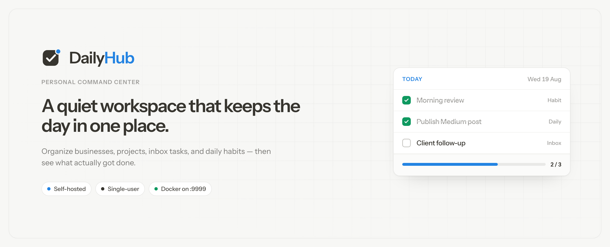
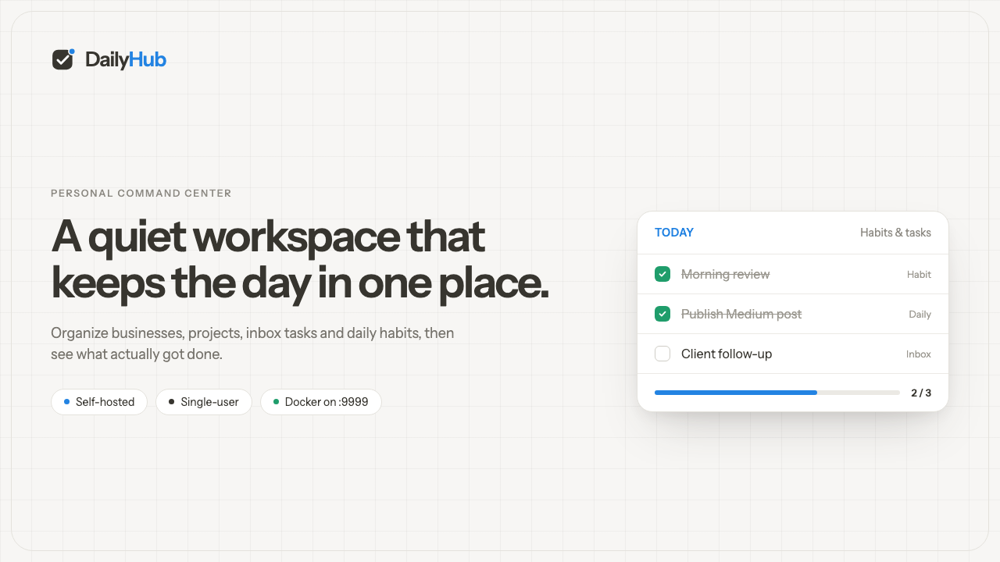
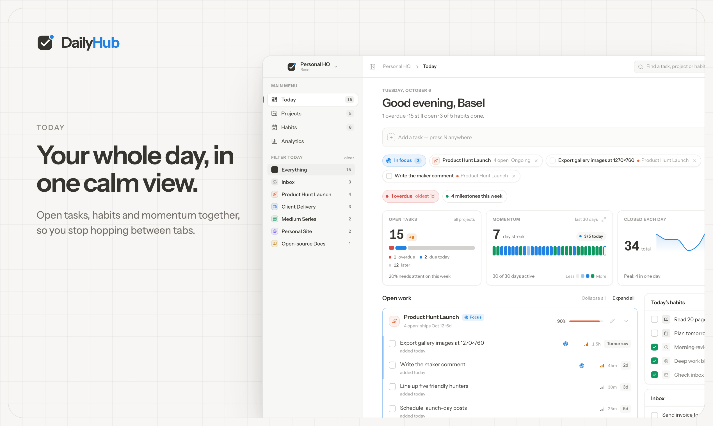
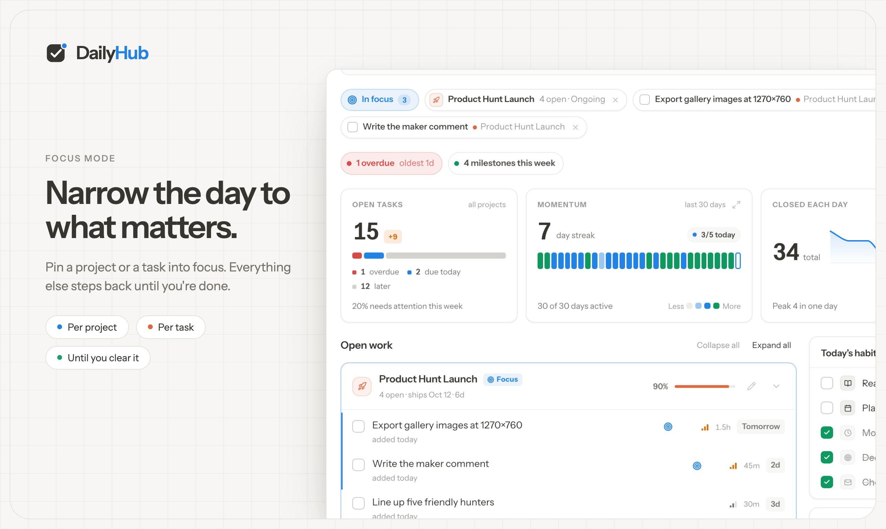
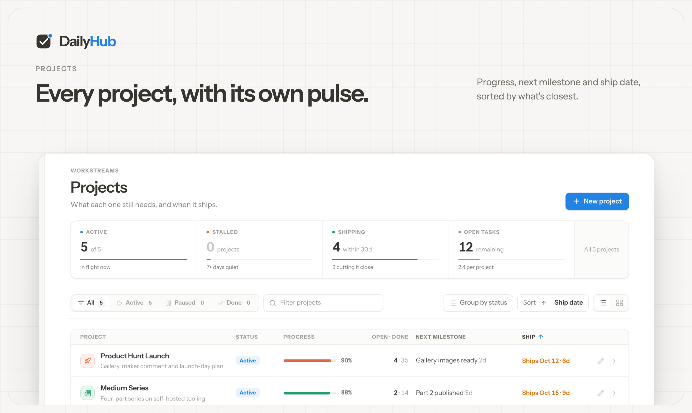
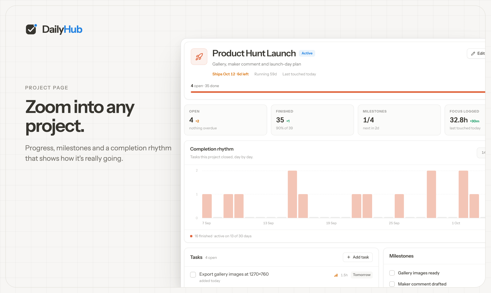
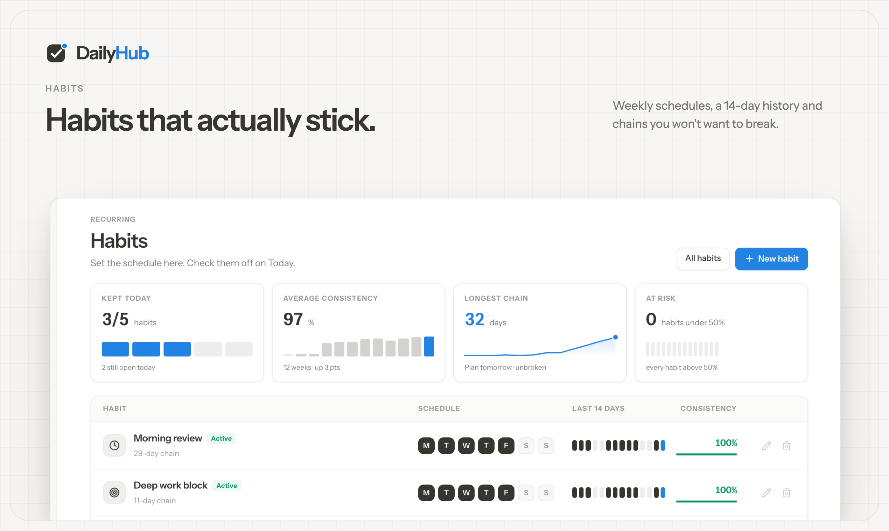
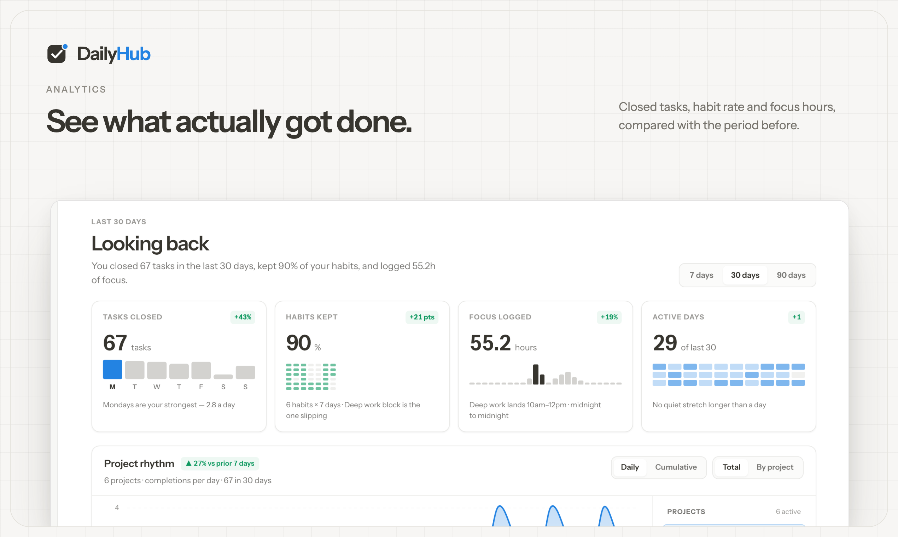
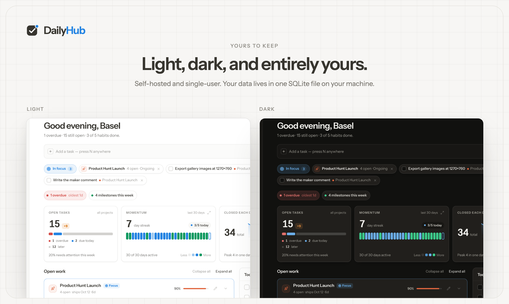

<p align="center">
  <a href="https://baselhusam.github.io/daily-hub/">
    
  </a>
</p>

<p align="center">
  <a href="https://www.npmjs.com/package/@baselhusam/daily-hub"></a>
  <a href="https://hub.docker.com/r/baselhusam/daily-hub"></a>
  <a href="https://github.com/baselhusam/daily-hub/actions/workflows/ci.yml"></a>
  <a href="LICENSE"></a>
  <a href="https://nodejs.org"></a>
  <a href="https://www.typescriptlang.org/"></a>
</p>

<p align="center">
  <a href="https://baselhusam.github.io/daily-hub/">Website</a>
  ·
  <a href="https://youtu.be/cAzb6aWz-hM">Demo video</a>
  ·
  <a href="https://www.npmjs.com/package/@baselhusam/daily-hub">npm</a>
  ·
  <a href="https://hub.docker.com/r/baselhusam/daily-hub">Docker Hub</a>
  ·
  <a href="docs/DEPLOYMENT.md">Docs</a>
  ·
  <a href="CHANGELOG.md">Changelog</a>
</p>

---

A personal command center for people who juggle **more than one project at a time**: founders, consultants, indie builders, anyone with client work, side projects, and a few daily habits they refuse to skip.

```bash
npx @baselhusam/daily-hub
```

One command, no account, no cloud. Your data stays in a SQLite file on your own machine.

## Why DailyHub

DailyHub does not replace Linear, Jira, or Notion. It is the **morning surface** that sits above them and answers four questions in one screen:

- **What is open?** Every task, grouped by the project it belongs to.
- **What belongs where?** An inbox for loose ends, projects for real workstreams.
- **What must happen today?** Habits on a weekly schedule, plus whatever you pinned in focus mode.
- **What did I already finish?** Completion history and analytics, so progress is visible instead of remembered.

It is built for one person. There are no teams, permissions, or notifications, and that is on purpose.

## See it in action

<p align="center">
  <a href="https://youtu.be/cAzb6aWz-hM">
    
  </a>
</p>

<details>
<summary><strong>More screenshots</strong></summary>
<br>

<p align="center">
  
</p>

<table>
  <tr>
    <td width="50%"></td>
    <td width="50%"></td>
  </tr>
  <tr>
    <td width="50%"></td>
    <td width="50%"></td>
  </tr>
  <tr>
    <td width="50%"></td>
    <td width="50%"></td>
  </tr>
</table>

</details>

## Features

**Plan the day**

- **Today**: a greeting, quick add, nudges, today’s habits, open work grouped by project, and an inbox
- **Focus mode**: pin projects or tasks so Today shows only what matters, until a date or until you clear it
- **Command palette**: press <kbd>⌘K</kbd> (<kbd>Ctrl+K</kbd>) to jump to any project, task, habit, or milestone

**Track the work**

- **Projects**: status, due dates, milestones, logos with auto-derived accent colours, and banners when work stalls
- **Habits**: weekday schedules, 14-day consistency, and completion rate
- **Analytics**: completions over time, a per-project breakdown, and weekday patterns

**Run it your way**

- **Local by default**: SQLite on disk, light and dark themes, no accounts
- **AI assistants**: a built-in [MCP endpoint](#use-it-from-an-ai-assistant-mcp) so Claude, Cursor, and other clients can read and update your tasks
- **macOS app**: a [Dock and Spotlight launcher](#macos-app) that starts DailyHub with one click
- **Docker**: a single multi-arch image for a home server or NAS

## Install

### npx (recommended)

Requires [Node.js 22+](https://nodejs.org/).

```bash
npx @baselhusam/daily-hub
```

It opens [http://127.0.0.1:9999](http://127.0.0.1:9999). The first download is about 80 MB because the package ships the full Next.js app. Later runs start straight away.

Want sample data to look around first?

```bash
npx @baselhusam/daily-hub --seed
```

<details>
<summary><strong>All options and commands</strong></summary>
<br>

| Option | What it does |
|--------|--------------|
| `--port <number>` | Use a different port (default `9999`) |
| `--data-dir <path>` | Store data somewhere other than `~/.daily-hub` |
| `--seed` | Add sample data on first start |
| `--no-open` | Don’t open the browser |
| `--no-mcp` | Turn off the local MCP endpoint |
| `--detach` | Run in the background and return to the shell |
| `--update` | Fetch and run the latest published version |

| Command | What it does |
|---------|--------------|
| `start` | Start DailyHub (the default) |
| `seed` | Add sample data and exit |
| `status` / `logs` / `stop` | Manage an instance started with `--detach` |
| `mcp` | Print MCP connection details for a running instance |
| `update` | Same as `--update` |
| `install-app` | Install `DailyHub.app` on macOS |

Options combine freely, so `npx @baselhusam/daily-hub --update --port 3000` updates and starts on port 3000.

</details>

### Run in the background

```bash
npx @baselhusam/daily-hub --detach
```

DailyHub opens once it is ready, and you can close the terminal. Manage it later with:

```bash
npx @baselhusam/daily-hub status
npx @baselhusam/daily-hub logs
npx @baselhusam/daily-hub stop
```

If you use a custom `--data-dir`, pass the same one to these commands. A detached instance runs until you stop it or restart the computer. For automatic restarts, use Docker or a system service.

### macOS app

```bash
npx @baselhusam/daily-hub install-app
```

This writes `DailyHub.app` into `~/Applications`, so DailyHub gets a Dock icon and a Spotlight entry. Opening it starts DailyHub in the background and opens it in your browser. Add `--app-mode` to get a chromeless Chrome window instead of a tab, or `--app-dir <path>` to install somewhere else.

The app is a launcher, not a bundled runtime, so Node.js 22+ still needs to be installed. Closing the browser leaves the server running; `npx @baselhusam/daily-hub stop` ends it.

### Docker

```bash
docker run -d --name dailyhub -p 9999:9999 \
  -e TZ=Europe/Berlin \
  -v dailyhub_data:/app/data \
  baselhusam/daily-hub:latest
```

Set `TZ` to your own timezone: the server decides when a day starts, and the container defaults to UTC. Open [http://localhost:9999](http://localhost:9999). Data persists in the `dailyhub_data` volume, and migrations run automatically on start. Images are built for `linux/amd64` and `linux/arm64`. Pin a release with `baselhusam/daily-hub:X.Y.Z` (it matches the npm version). The same tags are on [GHCR](https://github.com/baselhusam/daily-hub/pkgs/container/daily-hub) as `ghcr.io/baselhusam/daily-hub`.

```bash
docker exec dailyhub npm run db:seed   # optional sample data
```

From a clone, `docker compose up -d` pulls the same image and `docker compose up -d --build` builds from source. Reverse proxies, env vars, and troubleshooting are covered in [docs/DEPLOYMENT.md](docs/DEPLOYMENT.md).

## Use it from an AI assistant (MCP)

DailyHub includes a local [Model Context Protocol](https://modelcontextprotocol.io) server, so an AI assistant can work with your projects, tasks, and habits directly. For example, you can ask it to *“add a task to the website project for Friday”*, *“what’s still open in my inbox?”*, or *“mark today’s workout as done”*.

It is on by default at `/mcp` on the app’s port. With DailyHub running, print the connection details:

```bash
npx @baselhusam/daily-hub mcp
```

That prints a URL and a bearer token in the shape most clients accept:

```json
{
  "url": "http://127.0.0.1:9999/mcp",
  "headers": { "Authorization": "Bearer <token>" }
}
```

For Claude Code, the same details go in one command:

```bash
claude mcp add --transport http dailyhub http://127.0.0.1:9999/mcp --header "Authorization: Bearer <token>"
```

<details>
<summary><strong>Available tools</strong></summary>
<br>

| Area | Tools |
|------|-------|
| Projects | `list_projects`, `create_project`, `update_project` |
| Tasks | `list_tasks`, `create_task`, `update_task`, `set_task_completion` |
| Inbox | `list_inbox`, `create_inbox_item` |
| Habits | `list_habits`, `create_habit`, `update_habit`, `set_habit_completion` |
| Stats | `get_stats` |

</details>

The endpoint only listens on `127.0.0.1` and rejects requests without the token. The token is stored with owner-only permissions in `~/.daily-hub/daily-hub-mcp.json`. To turn the endpoint off, start DailyHub with `--no-mcp`.

## Your data

- **Where it lives**: `~/.daily-hub/`, which holds `data.db` (SQLite) and `uploads/` (project logos). Use `--data-dir` to move it. Under Docker it is the `/app/data` volume.
- **Backups**: stop DailyHub and copy that folder. That copy is the whole backup.
- **Don’t sync it live**: keep the data folder out of iCloud, Dropbox, and other sync tools. Syncing a SQLite file while it is open can corrupt it.
- **Upgrades**: run `npx @baselhusam/daily-hub --update`, or pull a newer Docker image. Database migrations apply on start, and the release notes say when a release includes one.
- **Security**: DailyHub has no login. Keep it on localhost, a private network, or behind an authenticating reverse proxy, and never expose port 9999 to the internet directly.

## Built with

[Next.js 15](https://nextjs.org) (App Router), TypeScript, SQLite with [Prisma](https://www.prisma.io), Tailwind CSS v4, [shadcn/ui](https://ui.shadcn.com), Motion, and Recharts. There is no separate API server: reads go through Server Components and writes go through Server Actions.

## Contributing

Bug reports, ideas, and pull requests are welcome. Start with [CONTRIBUTING.md](CONTRIBUTING.md) for setup and checks. The short version:

```bash
git clone https://github.com/baselhusam/daily-hub.git
cd daily-hub
npm install
npm run dev
```

This runs on port **9999** with a separate database in `./.data/`, so it never touches your real `~/.daily-hub/` data.

## Documentation

- [Deployment](docs/DEPLOYMENT.md): Docker, env vars, self-hosting, troubleshooting
- [Architecture](docs/ARCHITECTURE.md): data model and request flow
- [Design](docs/DESIGN.md): visual direction and UX patterns
- [Scope](docs/SCOPE.md): what is in and out of scope
- [Changelog](CHANGELOG.md): version history

## License

[MIT](LICENSE) © [Basel Husam](https://baselhusam.com)
